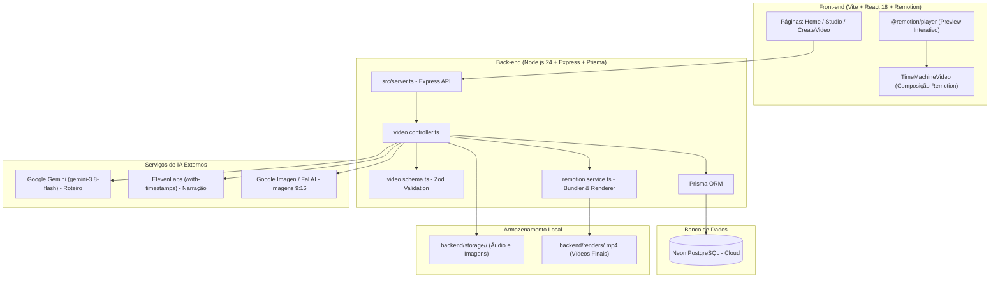

# AGENT.md — Fragata Shorts: Diretrizes de Engenharia e Arquitetura

> **Aviso Obrigatório para Agentes de IA e Desenvolvedores:**  
> A cada alteração, refatoração, correção ou adição feita no repositório, **é obrigatório informar e documentar explicitamente a mudança realizada**, detalhando os arquivos impactados, a motivação técnica e as verificações executadas. Mantenha também a seção [Histórico de Mudanças](#histórico-de-mudanças) deste arquivo sempre atualizada.

---

## 1. Visão Geral do Projeto

O **Fragata Shorts** é uma plataforma e Prova de Conceito (POC) de um motor automatizado e assistido para geração de vídeos curtos em formato vertical (`9:16`) focados em fatos históricos e narrativas ("Máquina do Tempo") para o TikTok, YouTube Shorts e Instagram Reels.

O sistema integra modelos de Inteligência Artificial generativa para escrita de roteiro, geração de imagens de fundo históricas, narração com voz neural sincronizada no nível de caracteres/palavras e renderização de vídeo programática utilizando o **Remotion**.

### Pilares de Valor do Projeto:
1. **Automação Inteligente com Controle Granular**: Capacidade de gerar vídeos de ponta a ponta com um clique ou editar individualmente roteiro, cenas, prompts, vozes e timing no Studio.
2. **Zero Desperdício de Créditos de IA**: Assets brutos (áudio, imagens, roteiro) são cacheados e persistidos no banco de dados (`remotionProps`) e em disco (`backend/storage/<id>/`). Re-renderizações ou ajustes de legenda não reexecutam chamadas pagas de IA.
3. **Sincronia Precisa de Fala e Legendas**: Uso de timestamps reais retornados pela API de TTS para calcular frames exatos (30 fps) para legendas dinâmicas e transições visuais.

---

## 2. Arquitetura do Sistema



### 2.1. Backend (`backend/`)
- **Runtime**: Node.js 22+ / 24+ com suporte nativo a execução TypeScript (`node src/server.ts`).
- **Framework**: Express 4 com CORS e parsing JSON.
- **Validação de Contratos**: Zod para tipagem estrita de payloads de entrada/saída.
- **Banco de Dados**: PostgreSQL em nuvem gerenciado via **Neon Database** (`DATABASE_URL`), utilizando Prisma ORM com suporte a SSL e pool de conexões.
- **Renderização Headless**: `@remotion/bundler` e `@remotion/renderer` para empacotar o código React e renderizar vídeos MP4 em segundo plano.
- **Serviços de IA**:
  - `gemini.service.ts`: Roteirização via `@google/genai` (`gemini-3.8-flash`) com structured JSON output.
  - `elevenlabs.service.ts`: Síntese de voz com alinhamento temporal nativo caractere a caractere (`/with-timestamps`).
  - `imagen.service.ts`: Geração de cenários verticais `9:16` com Gemini Image ou Fal AI.
  - `remotion.service.ts`: Orquestração de bundling Webpack e renderização MP4 via Remotion.

### 2.2. Frontend (`frontend/`)
- **Build Tool**: Vite 6 com React 18 e TypeScript.
- **Roteamento**: React Router v7 (`/`, `/create`, `/video/:id`).
- **Estilização**: Tailwind CSS.
- **Composições Remotion**:
  - `src/remotion/Root.tsx`: Declaração da composição principal `TimeMachineComposition`.
  - `src/remotion/TimeMachineVideo.tsx`: Timeline com `AudioTrack`, `Background`, `Avatar` e `Subtitles`.
  - `@remotion/player`: Reprodução em tempo real no Studio com suporte a scrub e playback instantâneo.

---

## 3. Estrutura do Repositório

```text
tiktok-videos/
├── .gitignore
├── .gitattributes
├── package.json                      # Scripts de orquestração do monorepo (root)
├── docker-compose.yml                # Contêiner PostgreSQL (tiktok-time-machine-db)
├── AI_PIPELINE_ARCHITECTURE.md       # Documento de arquitetura detalhada dos 3 pilares de IA
├── AGENT.md                          # Este manual de governança e arquitetura
│
├── backend/
│   ├── .env.example                  # Variáveis de ambiente necessárias
│   ├── package.json                  # Dependências do backend
│   ├── tsconfig.json                 # Configuração TypeScript NodeNext
│   ├── prisma/
│   │   └── schema.prisma             # Modelo de dados Video (PostgreSQL)
│   ├── renders/                      # Diretório de saída dos ficheiros .mp4 renderizados
│   ├── storage/                      # Cache de mídias brutas (<id>/audio.mp3, scene_*.jpg)
│   └── src/
│       ├── server.ts                 # Ponto de entrada do servidor Express
│       ├── controllers/
│       │   └── video.controller.ts   # Ações de criação, geração e renderização
│       ├── lib/
│       │   └── prisma.ts             # Instância singleton do Prisma Client
│       ├── routes/
│       │   └── video.routes.ts       # Declaração das rotas REST
│       ├── schemas/
│       │   └── video.schema.ts       # Validações Zod
│       └── services/
│           ├── elevenlabs.service.ts # Integração TTS + Timestamps
│           ├── gemini.service.ts     # Geração de Roteiro
│           ├── imagen.service.ts     # Geração de B-roll e Cenários
│           └── remotion.service.ts   # Bundling e renderização de vídeo
│
└── frontend/
    ├── package.json                  # Dependências do frontend
    ├── vite.config.ts                # Configuração do Vite
    ├── remotion.config.ts            # Configuração do Remotion
    ├── tailwind.config.js            # Design tokens e Tailwind CSS
    ├── tsconfig.json                 # Tipagem TypeScript do frontend
    ├── public/
    │   ├── avatars/                  # Sprites 2D do personagem/avatar
    │   └── ...                       # Assets estáticos padrão
    └── src/
        ├── main.tsx                  # Ponto de entrada React
        ├── App.tsx                   # Definição de rotas do SPA
        ├── pages/
        │   ├── Home.tsx              # Listagem de vídeos existentes
        │   ├── CreateVideo.tsx       # Criação rápida
        │   └── Studio.tsx            # Editor granular completo de storyboard & preview
        └── remotion/
            ├── index.ts              # Ponto de entrada do Remotion Studio
            ├── Root.tsx              # Registro da Composição Remotion
            ├── TimeMachineVideo.tsx  # Timeline do vídeo final
            ├── types.ts              # Definições de tipos de dados partilhados
            └── components/
                ├── AudioTrack.tsx    # Reprodução do áudio narrado
                ├── Avatar.tsx        # Exibição do avatar conforme timestamps
                ├── Background.tsx    # Transições de cenários b-roll
                └── Subtitles.tsx     # Legendas dinâmicas agrupadas em 3-5 palavras
```

---

## 4. Pipeline de Geração e Rotas da API

| Rota | Método | Descrição |
| :--- | :--- | :--- |
| `/health` | `GET` | Healthcheck do serviço backend |
| `/api/videos` | `GET` | Lista todos os vídeos criados no banco |
| `/api/videos/:id` | `GET` | Retorna os detalhes de um vídeo e suas `remotionProps` |
| `/api/videos` | `POST` | Cria um rascunho (`DRAFT`) sem custo de IA |
| `/api/videos/:id/generate-script` | `POST` | Etapa 1: Gera roteiro estruturado com o Gemini |
| `/api/videos/:id/generate-scene-images` | `POST` | Etapa 3A: Gera opções de imagens B-Roll para uma cena |
| `/api/videos/:id/generate-audio` | `POST` | Etapa 3B: Gera narração ElevenLabs e timestamps |
| `/api/videos/:id/render` | `POST` | Etapa 5: Renderiza o vídeo final MP4 em disco |
| `/api/videos/:id/rerender` | `POST` | Re-renderiza MP4 reaproveitando assets locais |
| `/api/videos/:id/title` | `PATCH` | Atualiza apenas o título do vídeo sem invalidar o MP4 |
| `/api/videos/:id` | `DELETE` | Exclui o vídeo do banco e apaga os arquivos de `storage/` e `renders/` |
| `/api/generate-video` | `POST` | Rota legada de automação ponta a ponta |

---

## 5. Regras Obrigatórias de Governança para Agentes e Desenvolvedores

### 1. Comunicação Obrigatória de Cada Mudança
- **Qualquer alteração efetuada no código**, em arquivos de configuração, scripts, banco de dados ou documentação **deve ser explicitamente descrita e reportada**.
- Indique:
  1. O que foi modificado;
  2. Por que foi modificado;
  3. Quais arquivos foram tocados;
  4. Quais testes/validações foram executados para garantir que não houve regressões.
- Mantenha a seção [Histórico de Mudanças](#histórico-de-mudanças) deste arquivo (`AGENT.md`) sempre atualizada com as entradas correspondentes.

### 2. Ambiente Node.js e Execução de Comandos (Windows)
- Conforme as regras do ambiente do usuário, sempre que executar comandos do ecossistema Node.js (`node`, `npm`, `npx`, `vite`, etc.) onde o executável não estiver no `PATH` padrão do PowerShell:
  1. Verifique se `D:\Node` está presente.
  2. Execute todos os comandos através do terminal `cmd` com o `PATH` configurado:
     ```powershell
     cmd /c "set PATH=D:\Node;%PATH% && <comando>"
     ```
  3. Não baixe novas instalações do Node.js se `D:\Node` estiver presente.

### 3. Alinhamento de Versões do Remotion
- Pacotes do ecossistema Remotion (`remotion`, `@remotion/bundler`, `@remotion/renderer`, `@remotion/player`, `@remotion/cli`) **devem sempre permanecer exatamente na mesma versão**. Descompassos de versão entre frontend e backend causam erros de serialização de webpack ou divergências na timeline.

### 4. Segurança de Dependências
- Mantenha auditorias de segurança (`npm audit`) sem vulnerabilidades de severidade Alta ou Crítica.
- Atualizações de segurança não devem quebrar contratos de tipagem do TypeScript ou comportamento da pipeline de renderização.

### 5. Preservação de Dados e Comportamento
- Não delete sem autorização explícita as pastas `backend/storage/` ou `backend/renders/`, pois elas contêm mídias geradas com custo de API.
- Preserve o fallback de mocks e o isolamento de chamadas assíncronas no controlador para prevenir falhas silenciosas na renderização.

---

## 6. Comandos Operacionais Mais Usados

```bash
# Iniciar o banco de dados PostgreSQL via Docker
npm run db:up

# Sincronizar schema Prisma com o banco
npm run db:push

# Gerar o cliente Prisma
npm run db:generate

# Iniciar o servidor Backend (porta 3333)
npm run dev:backend

# Iniciar o servidor Frontend (porta 5173)
npm run dev:frontend

# Iniciar o Remotion Studio autônomo
npm run dev:studio
```

---

## 7. Histórico de Mudanças

| Data | Responsável | Escopo | Descrição da Mudança |
| :--- | :--- | :--- | :--- |
| **2026-11-09** | Antigravity Agent | Governança | Criação do arquivo inicial `AGENT.md` documentando a arquitetura do projeto, fluxos da pipeline, contratos de API e regras de comunicação obrigatória de alterações. |
| **2026-11-09** | Antigravity Agent | Segurança / Dependências | Correção de vulnerabilidades de segurança (`npm audit` zerado): atualização do ecossistema Remotion (`remotion`, `@remotion/bundler`, `@remotion/renderer`, `@remotion/player`, `@remotion/cli`) para `4.0.542`, `zod` para `^4.6.7` e inclusão de `overrides` para `deepmerge-ts` (`^8.0.0`). Validação completa de compilação do frontend e execução dos schemas e cliente Prisma no backend. |
| **2026-11-09** | Antigravity Agent | Identidade / Branding | Ajuste do nome da aplicação para **Fragata Shorts** em todo o frontend (HTML title, Home, Studio), backend (schemas, controllers, server, logs, healthcheck), prompts de IA (Gemini system instruction) e manifestos (`package.json` raiz, frontend e backend). |
| **2026-11-09** | Antigravity Agent | Banco de Dados / Infra | Migração do Prisma ORM de PostgreSQL (Docker) para SQLite local (`backend/prisma/dev.db`), eliminando a necessidade de contêineres Docker e privilégios administrativos na máquina local. Atualizados `.env.example`, `.env`, `.gitignore` e schema do Prisma sincronizado com sucesso via `db:push`. |
| **2026-11-09** | Antigravity Agent | UI / UX (Frontend NLE) | Refatoração completa da Ilha de Edição (`frontend/src/pages/Studio.tsx` e `frontend/src/index.css`) para layout de aplicação Desktop NLE (`h-screen overflow-hidden`, estilo CapCut/Filmora) com paleta escura (`#141414`/`#181818`/`#1e1e1e`) e destaque Teal (`teal-400`), menu horizontal de 3 abas no Inspetor (`1. Briefing`, `2. Storyboard`, `3. Legendas`), monitor `@remotion/player` 9:16 com controlos de transporte via `PlayerRef`, e Timeline Multi-Track (Vídeo, Áudio e Legendas) com régua de Timecode, Playhead vivo e clique para seek. |
| **2026-11-09** | Antigravity Agent | Polimento UI / Calibração NLE | Refinamento visual do `Studio.tsx` e `index.css` com base no protótipo de referência: fundo profundo `#0f0f11`, painéis modulares arredondados `#18181c` com bordas `#2c2c32`/50, destaque `amber-500`, abas horizontais com ícones (`📝`, `🎬`, `💬`) e sublinhado luminoso, cards de cena colapsáveis com galerias B-Roll 9:16 com overlay e badge verde `✓ Aprovada`, rodapé fixo na sidebar (`Gravar Narração` + `Montar Vídeo`), barra compacta de player com barra de progresso e mute, e Linha de Tempo com miniatura nas cenas, ondas de áudio (waveform) e agulha vermelha viva (`bg-red-500`). |
| **2026-11-09** | Antigravity Agent | Ajustes Finos UX (`Studio.tsx`) | Ajustes no `frontend/src/pages/Studio.tsx`: renomeação das abas para `1. Roteiro` e `2. Cenas`; botão de retorno ao Dashboard contendo apenas ícone SVG de seta; remoção da pílula `DRAFT`; substituição do botão de exportação direto por menu dropdown de 3 pontos verticais (`⋮`) com opção `Exportar MP4`; unificação da largura da barra de controles com o container 9:16 do vídeo; remoção do botão duplicado de pause; adição de clique direto no vídeo para play/pause e indicador central `Pausado` quando o vídeo não está em reprodução. |
| **2026-11-09** | Antigravity Agent | Preview B-Roll & Scrubbing na Timeline (`Studio.tsx`) | Adicionado botão de ampliação (`top-2 right-2`, visível no hover) nos cards de imagem B-Roll da aba `2. Cenas` que abre um modal Lightbox para visualizar o cenário `9:16` em alta definição (com alternância entre opções e seleção direta). Convertida a agulha vermelha (playhead) e a área da `Linha de Tempo` para suportar arraste contínuo (`mousedown` + `mousemove` + `mouseup`), atualizando em tempo real o frame no `@remotion/player` (cenários, avatar e legendas) e destacando visualmente a cena e a legenda ativas no momento da agulha. |
| **2026-11-09** | Antigravity Agent | Sistema de Estilos de Legendas Sincronizadas & Posicionamento (`Subtitles.tsx`, `Studio.tsx`, `elevenlabs.service.ts`) | Implementado o sistema de legendas customizáveis e sincronizadas: (1) Quebra automática de falas longas em blocos curtos de 3 a 4 palavras com tempos por palavra (`words`), tanto a partir dos timestamps de caracteres da ElevenLabs quanto de forma proporcional no modo `DRAFT/Preview`; (2) Painel de estilos na aba `3. Legendas` com escolha de animação (`Karaokê`, `Pop TikTok`, `Hormozi`), fonte (`Impacto`, `Montserrat`, `Grotesque`, `Script`), slider de tamanho, seletores de Cor Principal e Cor de Destaque, interruptores de Borda Preta, Sombra e Fundo Box; (3) Posicionamento interativo por presets/sliders na aba 3 e por arraste direto da alça sobre o vídeo 9:16 (com `stopPropagation` para não disparar o Play/Pause do vídeo); (4) Persistência de `subtitleStyle` e `words` em `remotionProps` no banco de dados. |
| **2026-11-09** | Antigravity Agent | Seções Recolhíveis na Aba `3. Legendas` (`Studio.tsx`) | Adicionado comportamento de recolher/expandir (*accordion*) na aba `3. Legendas` do `frontend/src/pages/Studio.tsx` seguindo o padrão dos cards de cena: a seção **Estilo & Animação das Legendas** inicia recolhida (`isSubtitleStyleCollapsed = true`) e a seção **Blocos de Fala** inicia aberta (`isSubtitleBlocksCollapsed = false`). |
| **2026-11-09** | Antigravity Agent | Ajuste da Posição Padrão das Legendas (`50%`, `88%`) | Atualizadas as coordenadas padrão da legenda para `positionX = 50%` e `positionY = 88%` (em `backend/src/schemas/video.schema.ts`, `frontend/src/remotion/types.ts` e preset `Base` em `frontend/src/pages/Studio.tsx`), alinhando o texto à região inferior padrão das plataformas Shorts/TikTok. |
| **2026-11-09** | Antigravity Agent | Engenharia de Prompt Mixed Media 2D/3D (`gemini.service.ts`, `imagen.service.ts`, `TimeMachineVideo.tsx`) | Refatoração de `systemInstruction` em `backend/src/services/gemini.service.ts` e do sufixo de difusão em `backend/src/services/imagen.service.ts` para forçar a estética **Mixed Media 2D/3D Illustration** (boneco stickman 2D com cabeça redonda branca em estilo doodle, expressões em linha preta, membros de palito finos e trajes históricos texturizados, integrado fisicamente com iluminação volumétrica e sombras 3D no cenário e bloqueio de rostos humanos realistas). Desativado por padrão o overlay fixo `<Avatar />` (`showAvatarOverlay = false`) em `TimeMachineVideo.tsx` para não duplicar o personagem já presente na imagem. |
| **2026-11-09** | Antigravity Agent | Upload Manual de Imagem & Botão "Gerar IA" na Aba Cenas (`Studio.tsx`, `video.controller.ts`, `video.routes.ts`) | Na aba `2. Cenas` do `Studio.tsx`, o botão anterior foi substituído por dois botões lado a lado: (1) À esquerda, **📁 Adicionar Imagem** com seletor de arquivos local para envio manual de imagem com persistência em disco via endpoint `POST /api/videos/:id/upload-scene-image`; (2) À direita, **✨ Gerar IA** para acionar a geração de variações por inteligência artificial. |
| **2026-11-09** | Antigravity Agent | Correção do Erro 413 Payload Too Large na Gravação de Áudio (`Studio.tsx`, `server.ts`) | (1) Sanitizado o payload enviado pelo frontend em `handleGenerateAudio` e `handleGenerateSceneImages` para trafegar estritamente metadados de texto (`speaker`, `text`, `avatarSprite`, `imagePrompt`, `sfx_suggestion`), eliminando o envio acidental de imagens em Base64 para rotas de áudio; (2) Reiniciado o servidor backend com limite expandido de `50mb` no Express e proxy do Vite. |
| **2026-11-09** | Antigravity Agent | Diagnóstico ElevenLabs & Resolução SSL (`server.ts`) | Diagnóstico automatizado da API ElevenLabs validando que todas as 3 vozes (`Liam`, `Callum`, `George`) e a chamada TTS com timestamps funcionam perfeitamente (HTTP 200). Implementado tratamento em `server.ts` com `NODE_TLS_REJECT_UNAUTHORIZED='0'` em ambiente de desenvolvimento para evitar bloqueios de TLS (`SELF_SIGNED_CERT_IN_CHAIN`) gerados por inspeção HTTPS de antivírus ou roteadores locais. |
| **2026-11-10** | Antigravity Agent | Sala de Ideação Mix & Match e Camarim 360º (`IdeationDressingRoomTab.tsx`, `Studio.tsx`, `gemini.service.ts`) | Refatoração completa da `Aba 1. Roteiro` em 3 módulos: (1) **Camarim do Avatar 360º** com palco 3D elíptico, boneco Stickman SVG reativo em tempo real nos 4 ângulos (`Frente`, `Direita`, `Costa`, `Esquerda`), botões de rotação `<` e `>`, e seletores de Cabelo, Cor do Traço e Acessórios (`avatarConfig`) injetados automaticamente nos `imagePrompt`s; (2) **Motor de Ideação** (`generateTimeMachineIdeation`) que gera 4 opções reais no Gemini (`Humor`, `Ação`, `Sombrio`, `Caótico`) exibidas em 4 Accordions recolhíveis com seleção rápida por clique (`border-amber-500`); (3) **5º Accordion "🎬 Roteiro Final"** com reordenação por setas (`↑`/`↓`) e Drag & Drop, edição rápida de fala/voz e botão **"✨ Aprovar Roteiro"** que consolida e persiste o roteiro misturado no banco e avança para a Aba `2. Cenas`. |
| **2026-11-10** | Antigravity Agent | Upgrade Cinematográfico em 3 Fases: Design de Som (BGM/SFX), Câmera Ken Burns 4-Modos e Ritmo Viral (`AnimatedBackground.tsx`, `AudioTrack.tsx`, `gemini.service.ts`) | Implementação das 3 fases de retenção cinematográfica: (1) **Fase 1 (Design de Som)**: Geração de trilhas BGM (`public/bgm/epic.mp3`, `dark.mp3`, `fun.mp3`) em loop a 10% de volume com seletor de Vibe na Aba 1, mais disparo automático de `public/sfx/whoosh.mp3` via `<Sequence>` sincronizado no frame exato de cada corte de cena (`frameStart - 2`); (2) **Fase 2 (Movimento Matemático de Câmera)**: Criação de `AnimatedBackground.tsx` alternando matematicamente via `sceneIndex % 4` entre Zoom In (`1.0 -> 1.15`), Zoom Out (`1.15 -> 1.0`) e Pan direcional (`translateX`/`translateY`) diretamente sobre a imagem B-Roll Mixed Media; (3) **Fase 3 (Ritmo Narrativo Viral)**: Atualização do `systemInstruction` em `gemini.service.ts` (`VIRAL_PACING_INSTRUCTION`) instruindo o Gemini a variar o comprimento das falas (Gancho de 3-6 palavras, Desenvolvimento de 10-15 palavras intercalado com cortes rápidos e Clímax curto) respeitando o limite global `maxWords`. |
| **2026-11-10** | Antigravity Agent | Redimensionador de Colunas Interativo (`Studio.tsx`) | Adicionada divisória arrastável (*split-pane resizer*) no encontro entre a Coluna Esquerda (Inspetor) e a Coluna Direita (Monitor 9:16 & Linha de Tempo) em `frontend/src/pages/Studio.tsx`. Ao passar o mouse sobre a junção entre as duas telas, o cursor muda automaticamente para a seta horizontal dupla (`cursor-col-resize` / `↔`), permitindo arrastar com limites mínimo e máximo para a coluna direita (`MIN_RIGHT_WIDTH = 480px`, `MAX_RIGHT_WIDTH = 1480px`) e para o painel esquerdo (`340px` a `760px`), além de duplo clique para restaurar o padrão (`420px`). |
| **2026-11-10** | Antigravity Agent | Logo Oficial na Navbar (`Home.tsx`) | Substituído o título em texto `"Fragata Shorts"` no cabeçalho de `frontend/src/pages/Home.tsx` pela imagem oficial `/logo/fragata_shorts_logo.png` (`public/logo/fragata_shorts_logo.png`). |
| **2026-11-10** | Antigravity Agent | Exportação Inteligente de MP4 com Assinatura de Conteúdo e Auto-Download (`Studio.tsx`, `video.controller.ts`) | Removido o botão externo `"⬇ Baixar MP4"` do cabeçalho de `Studio.tsx`, unificando o fluxo na opção `"Exportar MP4"` do menu de 3 pontos (`⋮`). Implementado cálculo de assinatura determinística (`computeRenderSignature`) de todas as propriedades do vídeo (cenas, imagens B-Roll, narração, BGM, legendas e estilos), além de invalidação automática de `status = 'DRAFT'` no backend a cada edição: se nada mudou desde a última renderização, clicar em `"Exportar MP4"` baixa o arquivo `.mp4` imediatamente para a pasta Downloads; se houve qualquer alteração (ou se ainda não existe MP4), o sistema exibe a pílula temporária `"Renderizando MP4..."` e dispara o download automático da nova versão assim que a renderização termina. |
| **2026-11-10** | Antigravity Agent | Refatoração do Header do Studio: Logo, Edição de Título por Duplo Clique e Exclusão de Vídeo (`Studio.tsx`, `video.controller.ts`, `video.routes.ts`) | Implementadas 3 melhorias na barra superior de `Studio.tsx`: (1) Substituída a tag de status (`RENDERED`) pela imagem oficial `/logo/fragata_shorts_logo.png`; (2) Adicionada edição rápida do título ao dar duplo clique sobre o nome do vídeo no centro do header, abrindo um input com botão lateral `"Salvar"` conectado à rota `PATCH /api/videos/:id/title` (sem invalidar o MP4 existente); (3) Adicionada a opção `"Excluir Vídeo"` no menu de 3 pontos (`⋮`) que abre um modal exigindo digitar `"fragata shorts"` para confirmar e chama `DELETE /api/videos/:id`, removendo o registro no banco e limpando os diretórios `storage/:id` e `renders/:id.mp4`. |
| **2026-11-10** | Antigravity Agent | UX de Edição do Título: Fechar ao Clicar Fora (`Studio.tsx`) | Removido o botão de fechar (`✕`) ao lado de "Salvar". Adicionado listener de `mousedown` via `titleFormRef` para fechar o modo de edição sem salvar ao clicar em qualquer lugar fora do formulário, salvando exclusivamente ao clicar no botão "Salvar" ou pressionar `Enter`. |
| **2026-11-10** | Antigravity Agent | Auto-Reload do Backend (`backend/package.json`) | Adicionada flag nativa `--watch` ao comando `npm run dev` do backend (`node --watch ... src/server.ts`) para que rotas novas (como `DELETE /api/videos/:id` e `PATCH /api/videos/:id/title`) sejam recarregadas automaticamente em tempo de desenvolvimento sem necessidade de reiniciar manualmente. |
| **2026-11-10** | Antigravity Agent | Galeria B-Roll Limpa e Exclusão de Imagens com Lixeira (`Studio.tsx`) | Na aba `2. Cenas` do `Studio.tsx`: (1) Removidas as tags textuais de sobreposição `"Opção X"` e `"Selecionar / Aprovada"` para um visual limpo do card 9:16 (a seleção continua evidenciada pela borda esmeralda viva com glow); (2) Adicionado botão de lixeira no canto inferior direito que surge no hover para excluir imagens candidatas não desejadas; (3) Implementada regra de segurança que impede a exclusão da imagem que estiver selecionada no momento para a cena. |
| **2026-11-10** | Antigravity Agent | Reposicionamento da Lixeira para o Canto Inferior Esquerdo e Sincronização Automática (`Studio.tsx`) | Ajustado o botão de lixeira de exclusão de imagens B-Roll na aba `2. Cenas` para o **canto inferior esquerdo** (`bottom-2 left-2`), surgindo suavemente ao passar o mouse (`group-hover:opacity-100`). Bloqueada a exclusão da imagem atualmente selecionada (`disabled`, opacidade reduzida e cursor bloqueado). A função `handleDeleteBrollImage` agora persiste imediatamente a remoção no banco (`PUT /api/videos/:id/storyboard`), garantindo que imagens excluídas não reapareçam após recarregar a página. |
| **2026-11-10** | Antigravity Agent | Ocultação Total da Lixeira na Imagem Selecionada (`Studio.tsx`) | Ajustada a renderização condicional da lixeira para `!isSelected && (...)`. Na imagem que estiver atualmente selecionada para a cena, o elemento da lixeira é completamente omitido do DOM, eliminando qualquer fundo sombreado ou resíduo visual e mantendo o card 100% limpo com foco exclusivo na imagem aprovada. |
| **2026-11-10** | Antigravity Agent | Linters: ESLint no Frontend e Oxlint no Backend (`eslint.config.js`, `package.json`) | (1) **Frontend**: Configurado o ESLint com Flat Config (`eslint.config.js`) cobrindo React 18, TypeScript e Hooks. Resolvidos avisos de variáveis não utilizadas em `Studio.tsx` e `IdeationDressingRoomTab.tsx`, além de evitar `no-useless-assignment` em `AnimatedBackground.tsx` (resultado: 0 erros); (2) **Backend**: Adicionado `oxlint` como dependência de desenvolvimento no backend com script `npm run lint`. Removida constante `USE_AI_MOCK` não utilizada em `video.controller.ts` (resultado: 0 erros e 0 avisos em 15ms); (3) Adicionados scripts unificados `npm run lint`, `npm run lint:frontend` e `npm run lint:backend` na raiz do projeto. |
| **2026-11-10** | Antigravity Agent | Refatoração Premium do Palco do Avatar (`AvatarStage.tsx`, `IdeationDressingRoomTab.tsx`) | Modularização e refatoração completa do palco do protagonista: (1) **Fase 1 (SVG Dinâmico Puro)**: Criação de `AvatarStage.tsx` com renderização puramente vetorial SVG em tempo real; remoção de qualquer colete, roupa ou preenchimento verde (corpo stickman base com traço fino responsivo a `strokeColor`, feições expressivas, cabelo dinâmico e acessórios como óculos redondos com lentes translúcidas); (2) **Fase 2 (Iluminação de Estúdio Limpa)**: Remoção dos halos verdes/teal; introdução de holofote superior suave (`radial-gradient` branco translúcido) e elipse 3D de chão minimalista; (3) **Fase 3 (Rotação Limpa)**: Remoção dos botões de texto inferiores redundantes, preservando exclusivamente as setas circulares flanqueadoras `<` e `>` com animação 3D suave (`perspective` + `rotateY`) integrada à anatomia do personagem. |
| **2026-11-10** | Antigravity Agent | Holofote Cônico Volumétrico & Seletor de Cor do Cabelo (`AvatarStage.tsx`, `IdeationDressingRoomTab.tsx`, `gemini.service.ts`, `video.schema.ts`, `types.ts`) | (1) **Holofote Cônico Volumétrico**: Implementada iluminação teatral no `AvatarStage.tsx` com lâmpada emissora no topo central e feixe volumétrico em formato de cone descendente (`polygon` SVG com gradientes lineares translúcidos, arestas luminosas suaves e brilho elíptico na base do piso), projetando a luz de estúdio diretamente sobre o boneco e a elipse do palco; (2) **Personalização de Cor do Cabelo (`hairColor`)**: Adicionada a propriedade `hairColor` no `AvatarConfig` (frontend, backend Zod schema e Gemini service); adicionado painel visual com 7 swatches pré-definidos (Preto, Castanho, Loiro, Ruivo, Prateado, Rosa, Ciano) e seletor `Custom` na aba do Camarim, com desativação contextual quando o estilo careca estiver ativo (`opacity-40` e aviso `(Não aplicável a careca)`); o SVG do avatar aplica dinamicamente o preenchimento `fill={hairColor}` nas mechas de cabelo enquanto preserva o traço cartunesco `stroke={stroke}`. |
| **2026-11-10** | Antigravity Agent | Unificação do Estilo de Cabelo e Cor Padrão Ruivo `#EA580C` (`IdeationDressingRoomTab.tsx`, `AvatarStage.tsx`, `types.ts`, `video.schema.ts`) | Refatoração da seção **1. Estilo de Cabelo** no Camarim: (1) Unificação lado a lado (`grid-cols-2`) do seletor dropdown de corte com o container de cor do cabelo, com mesma altura (`h-[38px]`); (2) Simplificação da paleta de cabelo para um único círculo com a cor padrão ruiva `#EA580C` selecionada por padrão e o botão lateral `Custom` (com indicador visual em miniatura da cor ativa ao lado do texto); (3) Exibição do código HEX `#EA580C` à direita no cabeçalho da seção; (4) `2. Acessórios` e `3. Cor do Traço (Ink Line)` reposicionados ordenadamente abaixo de forma fluida. |
| **2026-11-10** | Antigravity Agent | Painel do Avatar Recolhível e Expansível (`IdeationDressingRoomTab.tsx`) | Adicionado comportamento de acordeão no card do Avatar (`Módulo 1: Camarim 360º`): estado `isAvatarOpen` gerenciado dinamicamente, cabeçalho clicável (`cursor-pointer`, hover suave e borda inferior condicional), e ícone chevron animado com rotação de 180° (`rotate-180`), permitindo ao usuário recolher o palco 3D e os controles para focar no formulário de geração de roteiro. |
| **2026-11-10** | Antigravity Agent | Novo Design do Mascote Oficial Fragata Shorts & Acessório de Pescoço (`AvatarStage.tsx`, `IdeationDressingRoomTab.tsx`, `types.ts`, `video.schema.ts`, `gemini.service.ts`) | Implementação fiel da identidade visual do mascote oficial: (1) **`AvatarStage.tsx`**: Renderização SVG do personagem com tronco branco cartunizado e bordas de nanquim, pose com mãos na cintura e cotovelos projetados em triângulo (`< >`), cabelo espetado (`spiky`) com 5 pontas afiadas em laranja `#EA580C`, óculos retrô na testa (`forehead_goggles`) com armação e tira de couro, fivela traseira na rotação de costas e lentes ciano espelhadas com brilho reflexivo duplo, bandana vermelha dobrada no pescoço (`red_bandana`) com nó lateral e pontas esvoaçantes, e feições expressivas com sobrancelha arqueada, olho aberto com brilho, piscadela (`wink`) e smirk lateral com dentes brancos visíveis nos 4 ângulos de rotação 3D (`Frente`, `Direita`, `Costas`, `Esquerda`); (2) **`IdeationDressingRoomTab.tsx`**: Seção `2. Acessórios` reformulada em layout de 2 colunas lado a lado (`grid-cols-2`) sem títulos redundantes, comportando os seletores de Cabeça/Testa e Pescoço com mesma altura `h-[38px]`; (3) **Contratos e Prompt Engineering (`types.ts`, `video.schema.ts`, `gemini.service.ts`)**: Adição de `AvatarNeckAccessory` (`none` | `red_bandana`), padronização de `forehead_goggles` e injeção dos novos descritores anatômicos nos prompts do Gemini e geradores de imagem. |
| **2026-11-10** | Antigravity Agent | Ajuste de Layout da Seção Cor do Traço (`IdeationDressingRoomTab.tsx`) | Na seção 3 do Camarim: (1) Removido o termo redundante `(Ink Line)`, mantendo o rótulo limpo `3. Cor do Traço`; (2) Eliminado o `overflow-x-auto` da lista de swatches, impedindo o surgimento da barra de rolagem horizontal ao selecionar ou passar o mouse sobre a última cor; (3) Padronizado o tamanho dos círculos para `h-5 w-5` (alinhado à seção 1) e ajustado o espaçamento do container para `px-3 py-1.5 min-h-[38px]`, garantindo que o primeiro círculo (`#111827`) e seu anel de seleção (`ring-2`) não sofram corte nas bordas superior e esquerda. |
| **2026-11-10** | Antigravity Agent | Briefing Rico & Geração de Títulos Virais por Opção (`IdeationDressingRoomTab.tsx`, `Studio.tsx`, `gemini.service.ts`, `video.schema.ts`) | Evolução da Etapa 1 de Briefing: (1) **Textarea Expansível no Frontend**: Substituição do input simples por textarea `Briefing & Fatos da Viagem` (`rows=5`) com placeholder dinâmico exemplificando a estrutura ideal (Tema, Fatos/Mitos e Direção opcional de cenas); (2) **Geração de Títulos Virais no Gemini**: O `systemInstruction` em `gemini.service.ts` foi atualizado para gerar títulos magnéticos de alta retenção no estilo Shorts/TikTok para cada uma das 4 opções, e adotar o modelo híbrido inteligente (se o usuário detalhar cenas cronológicas, o Gemini respeita essa progressão adaptando os tons); (3) **Consolidação do Título no Roteiro Final**: O 5º acordeão do Roteiro Final exibe o título viral sugerido em campo editável, que ao ser aprovado assume automaticamente o título do projeto no Studio e no banco de dados; (4) **Validação no Backend**: Expansão do limite de caracteres do briefing de 180 para 4000 em `generateScriptSchema`. |
| **2026-11-10** | Antigravity Agent | Estruturação e Expansão Completa do Repertório Sonoro em Pastas (`public/bgm/ambient/`, `public/bgm/effects/`, `public/bgm/music/`) | Estruturação de toda a biblioteca de áudio em subpastas organizadas dentro de `public/bgm/`: (1) **`bgm/ambient/`**: 6 sons ambientes contínuos com conversão via FFmpeg de WAV/FLAC para MP3 192k otimizados (`amazon-jungle.mp3`, `medieval-market.mp3`, `campfire.mp3`, `rain.mp3`, `forest.mp3`, `bunker-cave.mp3`); (2) **`bgm/effects/`**: 14 efeitos sonoros pontuais de alta qualidade (`swoosh.wav`, `cannon-artillery.wav`, `record-scratch.wav`, `riser-hit.wav`, `metal-hits.mp3`, `trex-roar-fight.wav`, `trex-roar.wav`, `cartoon-blink.mp3`, `sword-clash.wav`, `sword-draw.wav`, `heartbeat.wav`, `footsteps-stone.wav`, `dog-bark.wav`, `piano-flourish.wav`, `whoosh.mp3`); (3) **`bgm/music/`**: 8 trilhas musicais para narração (`epic-hiphop.mp3`, `action-run.mp3`, `fast-piano.mp3`, `mountain-intro.mp3`, `fun-light.mp3`, `funny-vlog.mp3`, `epic.mp3`, `dark.mp3`); (4) **Remoção de Duplicatas e Atualização de Rotas**: Excluídos arquivos duplicados na raiz de `bgm/` e a pasta `sfx/`; atualizados `BGM_VIBE_OPTIONS` em `types.ts`, `bgmVibeSchema` no backend Zod e o `<AudioTrack>` para referenciar diretamente `bgm/music/` e `bgm/effects/whoosh.mp3`. |
| **2026-11-10** | Antigravity Agent | Direção de Som com IA: Escolha Automática de BGM por Opção e SFX Cirúrgico por Cena (`gemini.service.ts`, `IdeationDressingRoomTab.tsx`, `AudioTrack.tsx`, `Studio.tsx`, `video.controller.ts`, `types.ts`, `video.schema.ts`) | Automação e refinamento do design de som: (1) **Decisão Automática de BGM pela IA**: Adicionada a opção padrão `"🤖 Decisão da IA (Recomendado por Ângulo)"` (`'auto'`) no seletor de trilha do briefing; o Gemini seleciona a `bgmVibe` mais adequada para cada um dos 4 ângulos narrativos (`humor` -> `comedy`/`fun`, `action` -> `action`/`hiphop`, etc.); (2) **Efeitos Sonoros Específicos por Cena (`sfx_suggestion`)**: O roteirista Gemini escolhe para cada cena exatamente um dos 15 efeitos sonoros do estúdio (`cannon-artillery`, `record-scratch`, `cartoon-blink`, `riser-hit`, `heartbeat`, etc.), exibidos em badges nos cards das opções e configuráveis por dropdown no Roteiro Final; (3) **Execução de SFX em Tempo Real no Remotion**: `AudioTrack.tsx` recebe as cenas e sincroniza a reprodução do efeito sonoro específico de cada cena no corte visual exato; (4) **Edição e Pré-visualização**: O 5º acordeão do Roteiro Final exibe lado a lado o Título Viral e a Trilha Sonora BGM selecionada pela IA (permitindo ajuste antes da aprovação), mantendo sincronia com o `@remotion/player`. |
| **2026-11-10** | Antigravity Agent | Arquitetura Híbrida de Sound Design & ElevenLabs Text-to-SFX (`gemini.service.ts`, `elevenlabs.service.ts`, `video.controller.ts`, `video.routes.ts`, `IdeationDressingRoomTab.tsx`, `Studio.tsx`, `AudioTrack.tsx`) | Implementação da abordagem híbrida de efeitos sonoros: (1) **Prompt Acústico do Roteirista (`sfx_prompt`)**: O Gemini agora gera para cada cena uma descrição acústica detalhada em inglês (ex: *"Loud explosive blast of an 18th-century cannon in a sandy desert..."*), visível nos cards de ideação, no Roteiro Final e na aba Cenas; (2) **Endpoint Text-to-SFX ElevenLabs**: Criação de `POST /api/videos/:id/generate-scene-sfx` e serviço `generateSoundEffect` integrados à API da ElevenLabs (`/v1/sound-generation`), gerando arquivos MP3 sob demanda salvos em `storage/:id/` e vinculados a `custom_sfx_url`; (3) **Controles no Editor**: Botão *"✨ Gerar SFX"* com player de áudio direto no card da cena e botão de remoção para alternar entre áudio gerado por IA e a biblioteca local de zero-custo; (4) **Prioridade no Remotion**: `AudioTrack.tsx` prioriza `custom_sfx_url` para tocar no corte exato da cena. |
| **2026-11-10** | Antigravity Agent | Calibração de Ritmo Narrativo (Pacing) & Reorganização Visual dos Cards de Cena (`gemini.service.ts`, `video.schema.ts`, `video.controller.ts`, `types.ts`, `IdeationDressingRoomTab.tsx`, `Studio.tsx`) | (1) **Calibração de Ritmo e Piso Estrito de Palavras**: Correção do ritmo para o preset de 30s (`medium`) e 60s (`long`) com contagem calibrada baseada na taxa do ElevenLabs de ~2.4 palavras/s: 15s (32 a 42 palavras, 3 a 5 cenas), 30s (65 a 78 palavras, 5 a 7 cenas, 10 a 14 palavras/cena) e 60s (130 a 150 palavras). O prompt do Gemini agora proíbe expressamente gerar menos do que `minWords` para eliminar lacunas de silêncio; (2) **Descrição do Cenário em Português (`visual_description`)**: O Gemini gera para cada cena o resumo visual do cenário e da ação do personagem em português, integrado aos schemas Zod e types; (3) **Hierarquia Visual dos Cards de Cena**: Reorganização dos cards no Brainstorming (Módulo 2) e Roteiro Final (Módulo 3): Topo (Cena #X + ação), 1. Cenário (`🖼️ Cenário: [visual_description]`), 2. Locutor à esquerda alinhado com a fala (`[🧑 Protagonista] "..."`), 3. Design de som integrado (Som da biblioteca + Prompt IA ElevenLabs); (4) **Feedback em Tempo Real**: O cabeçalho do Roteiro Final calcula e exibe em tempo real o total de palavras e duração estimada de áudio. |
| **2026-11-10** | Antigravity Agent | Correção e Limpeza Completa de Linter no Frontend (`Root.tsx`, `Studio.tsx`) | (1) Resolução da tipagem de `<Composition>` em `Root.tsx`, removendo o uso de `any` e import desnecessário de `TimeMachineVideoProps`; (2) Tratamento das dependências exaustivas de hooks (`react-hooks/exhaustive-deps`) em `Studio.tsx` (`fetchVideoData`, polling de renderização e arraste da timeline); (3) Execução do linter com 0 erros e 0 warnings no frontend (`eslint src`) e backend (`oxlint src`). |
| **2026-11-10** | Antigravity Agent | Anatomia 2D Stickman, Expressões e Poses Dinâmicas & Auto-Enriquecimento de Cenas (`gemini.service.ts`, `imagen.service.ts`, `video.controller.ts`, `video.routes.ts`, `video.schema.ts`, `types.ts`, `IdeationDressingRoomTab.tsx`, `Studio.tsx`) | (1) **Anatomia Fiel (Tronco com Espessura vs Linha Única)**: Atualização do descritor de avatar (`buildAvatarPromptDescriptor` e `buildClientAvatarPromptDescriptor`) e do sufixo de difusão (`imagen.service.ts`) para exigir explicitamente tronco branco sólido em formato de cápsula com espessura e contorno a nanquim (`distinct solid white capsule torso with smooth thickness outlined in clean ink (NOT a stick-line torso)`), com braços e pernas finos de palito, impedindo que a IA desenhe tronco de linha única; (2) **Expressões e Poses Dinâmicas por Cena**: Removida a expressão fixa (*"winking with cocky smirk"*) e pose estática (*"hands on hips"*) do descritor base; o Gemini agora gera dinamicamente expressões faciais atreladas ao `avatarSprite` (talking, shocked, scared, happy, angry, laughing, thinking) e ações físicas vivas no ambiente 3D (escalando, correndo, escorregando, apontando, espiando); (3) **Regra Geral para Personagens Secundários**: Exigência de que todos os personagens e multidões na cena (soldados de Napoleão, Sa'im al-Dahr, etc.) sejam 2D cartoon stickmen com tronco com espessura e trajes de época (proibindo humanos fotorrealistas); (4) **Correção do Bug de Concatenação no Regex**: Correção de `injectAvatarConfigIntoPrompt` e adição de `sanitizePromptArtifacts` eliminando a tripla repetição de *"with hands on hips outlined in #111827 ink"*; (5) **Auto-Revisão ao Aprovar Roteiro & Botão "🪄 Gerar com IA"**: Implementado endpoint `POST /api/videos/:id/generate-scene-prompt` e função `generateSingleScenePrompt`; ao clicar em "Aprovar Roteiro", o sistema auto-enriquece cenas autorais ou sem prompt com descrições visuais completas e prompts sonoros antes de ir para a Etapa 2; adicionado botão *"🪄 Gerar Prompt Visual"* no Roteiro Final e *"🪄 Gerar com IA"* na aba Cenas do Studio. |
| **2026-11-10** | Antigravity Agent | Revisão Holística do Roteiro Final pelo Gemini & Prompts Baseados no Cenário do Usuário (`gemini.service.ts`, `video.controller.ts`, `video.routes.ts`, `video.schema.ts`, `Studio.tsx`, `IdeationDressingRoomTab.tsx`) | (1) **Endpoint de Revisão do Roteirista (`POST /api/videos/:id/review-final-script`)**: Ao clicar em "Aprovar Roteiro", a sequência completa de cenas montadas pelo usuário é submetida ao Gemini em lote antes de avançar para a Etapa 2; (2) **Geração de Prompt Baseada na Descrição do Usuário**: Se o usuário adicionou cenas extras autorais ou preencheu a descrição do cenário (`visual_description`), o Gemini analisa a ação e os elementos informados pelo usuário e sintetiza o `imagePrompt` em inglês fiel a essas instruções, acompanhado da expressão correta (`avatarSprite`) e do efeito sonoro ideal (`sfx_suggestion`/`sfx_prompt`); (3) **Feedback Visual**: Botão de aprovação exibe status animado *"O Roteirista está analisando e gerando os prompts..."* durante a revisão holística. |
| **2026-11-10** | Antigravity Agent | Multi-Diálogos por Cena & Componente Reutilizável `SceneCard` (`SceneCard.tsx`, `IdeationDressingRoomTab.tsx`, `Studio.tsx`, `types.ts`, `video.schema.ts`, `elevenlabs.service.ts`, `gemini.service.ts`) | (1) **Refatoração da Interface de Cena**: Criação do tipo `DialogueItem` (`{ id: string, speaker: SpeakerType, text: string }`) e propriedade `dialogues?: DialogueItem[]` em `StoryboardScene` e schemas Zod com backward compatibility automática via `getSceneDialogues()` e `getSceneFullText()`; (2) **Componente Reutilizável `<SceneCard />`**: Criação de `frontend/src/components/SceneCard.tsx` com renderização dinâmica por `.map()` de cada fala (Select de Orador + Textarea), botão discreto `[ + Nova Fala ]` para injetar novos diálogos na mesma cena e botão de remoção `[ × ]` para falas extras; (3) **Integração nas Abas 1 e 2**: Substituição do código inline no Roteiro Final de `IdeationDressingRoomTab.tsx` e na aba Cenas de `Studio.tsx` com as funções `handleAddDialogue`, `handleUpdateDialogue` e `handleRemoveDialogue`; (4) **Motor TTS da ElevenLabs Sequencial**: Atualização de `elevenlabs.service.ts` para sintetizar múltiplos diálogos por cena com as vozes dos respectivos oradores em sequência, acumulando os tempos de fala e mantendo a duração do cenário sincronizada; (5) **Qualidade**: Linter com 0 avisos e 0 erros e TypeScript build 100% verificado. |
| **2026-11-10** | Antigravity Agent | Correção do Reinício do Servidor Durante Renderização Remotion (`backend/package.json`) | Correção crítica no script `"dev"` do backend adicionando `--watch-path=src`. Anteriormente, `node --watch` sem restrição de pasta monitorava todo o diretório `backend/`, reiniciando o servidor instantaneamente ao detectar a escrita em `backend/prisma/dev.db` ou `backend/renders/` e matando o processo do Remotion no meio da renderização. Com `--watch-path=src`, alterações em banco de dados, renders e storage não reiniciam o servidor. |
| **2026-11-11** | Antigravity Agent | Geração Nativa de Múltiplos Diálogos por Cena pelo Roteirista Gemini (`gemini.service.ts`, `video.controller.ts`) | Conexão do Roteirista (Gemini) à arquitetura de multi-diálogos: (1) **Diretrizes de Interação e Diálogo**: Atualizado o `systemInstruction` em `generateTimeMachineIdeation`, `generateTimeMachineScript` e `reviewAndEnrichFinalScript` instruindo o modelo a gerar organicamente de 1 a 3 falas sequenciais no array `dialogues` (Protagonista x Personagem, Personagem x Personagem, ou Protagonista x Narrador), com ritmo livre por fala respeitando o limite global de palavras do vídeo; (2) **Interação Visual Obrigatória no `imagePrompt` e `visual_description`**: Exigência de que o prompt visual em inglês e o resumo em português retratem explicitamente a contracena física entre os personagens envolvidos no diálogo (ex: viajante gesticulando com o operário/guarda egípcio); (3) **Schemas de Resposta Zod & Gemini**: Inclusão de `dialogues: Array<{ speaker, text }>` no `responseSchema` de ideação, roteiro direto e revisão holística; (4) **Preservação e Mapeamento de IDs**: Ajustado `video.controller.ts` para mapear todos os diálogos gerados sem achatá-los em fala única, sincronizando `speaker` e `text` consolidados para retrocompatibilidade; (5) **Verificação**: Linters zerados (0 erros, 0 avisos) no frontend e backend e build de produção bem-sucedido. |
| **2026-11-11** | Antigravity Agent | Seamless Loop (>100% Retenção Algorítmica) & 4 Arquiteturas Narrativas (`gemini.service.ts`, `video.schema.ts`, `elevenlabs.service.ts`, `IdeationDressingRoomTab.tsx`, `types.ts`, `video.controller.ts`) | Implementação da técnica de Loop Perfeito (Seamless Loop / Narrativa Circular): (1) **4 Arquiteturas Narrativas**: Substituição dos IDs de tom por arquiteturas de enredo (`in_media_res`, `myth_buster`, `witness_pov`, `ticking_clock`), desacoplando o tom para variável transversal injetada; (2) **Geração Guiada por `narrative_plan` com `propertyOrdering`**: O Gemini gera primeiro a oração de conexão inteira (`bridge_full_sentence`) decomposta em `loop_closing_fragment` (última cena) e `loop_opening_fragment` (primeira cena) antes do corpo de cenas; (3) **Blacklist Rígida e Higienizador Regex**: Proibição estrita de pontuação final (`.`, `!`, `?`, `…`), CTAs e clichês no prompt, combinada com higienizador regex pós-geração que limpa pontuações estritamente na última fala do último diálogo da última cena; (4) **Engenharia de Áudio ElevenLabs Cirúrgica**: Injeção de `next_text: firstSpeechText` no último chunk para manter a entonação suspensa sem queda de pitch, e redução da margem de silêncio final de 0.5s para 0.06s (~2 frames a 30 FPS) preservando o decaimento vocal sem engasgo; (5) **Feedback Visual em Tempo Real no Frontend**: Exibição da ponte do loop nos cartões de ideação e badge dinâmico de integridade no 5º acordeão do Roteiro Final (`🔁 Loop Perfeito Ativo` vs `⚡ Ponte Híbrida`); (6) **Verificação Completa**: 0 erros no Oxlint (backend), 0 erros no ESLint (frontend) e build Vite de produção aprovado. |
| **2026-11-11** | Antigravity Agent | Personalidade do Billy, Dinâmica em Dupla & bridge_speaker (`gemini.service.ts`, `video.schema.ts`, `types.ts`, `IdeationDressingRoomTab.tsx`, `Studio.tsx`) | Refinamento da voz autoral e continuidade acústica: (1) **Personalidade do Billy (`protagonist`)**: Injeção de diretrizes rígidas exigindo português coloquial brasileiro ("pra", "tá", "né", "olha só", "peraí", "cara", "sério", "deu ruim", "bizarro"), reações viscerais ("Espera aí...", "O quê?!", "Caramba...", "Não, sério mesmo?") e proibição de tom professoral ou formal; (2) **Dinâmica em Dupla (Narrador Sério x Billy Atrapalhado)**: O Narrador expõe fatos históricos e datas com rigor documental, enquanto o Billy interrompe, tira conclusões precipitadas e vive o perigo físico, com bate-bola ágil de 1 a 3 falas por cena; (3) **Regra do `bridge_speaker` no Loop Perfeito**: Restrito estritamente a `['protagonist', 'narrator']` (excluindo personagens secundários `character`); a primeira fala da Cena 1 e a última fala do vídeo pertencem compulsoriamente ao mesmo orador para timbre vocal contínuo no reinício do player; (4) **Blindagem de Monetização TikTok/Reels**: Preset longo calibrado para 145 a 175 palavras (~65s, 10 a 14 cenas dinâmicas), garantindo que o áudio nunca fique abaixo de 60 segundos; (5) **Feedback Visual**: Exibição da voz responsável pelo loop (`🧑 Billy` ou `🎙️ Narrador`) nos cards de prévia de cada opção no frontend; (6) **Verificação**: Oxlint e ESLint com 0 erros e 0 warnings, e build Vite concluído com sucesso. |
| **2026-11-11** | Antigravity Agent | Biblioteca Global de Efeitos Sonoros Reutilizáveis & Catálogo CustomSfx (`schema.prisma`, `sfx-library.service.ts`, `video.controller.ts`, `video.routes.ts`, `gemini.service.ts`, `AudioTrack.tsx`, `SceneCard.tsx`, `Studio.tsx`, `IdeationDressingRoomTab.tsx`, `types.ts`, `video.schema.ts`) | Sistema completo de catálogo, salvamento em 1-clique e reutilização perpétua de efeitos sonoros gerados por IA com custo zero: (1) **Banco de Dados & Contratos**: Criação da tabela `CustomSfx` no Prisma (`id`, `slug @unique`, `label`, `prompt`, `filePath`, `createdAt`) 100% compatível com SQLite local e Neon PostgreSQL; adição do campo `sfx_label` (título em português com emoji) e esquema `promoteSfxSchema`; (2) **Serviço de SFX Library no Backend**: Implementação de `sfx-library.service.ts` centralizando 15 efeitos padrão e customizados; função `promoteSceneSfxToLibrary` que gera slug sanitizado único, copia o `.mp3` de `storage/<id>/` para `frontend/public/bgm/effects/<slug>.mp3`, grava na tabela `CustomSfx` e vincula a cena ao novo som com `custom_sfx_url = null`; endpoints `GET /api/sfx-library`, `POST /api/sfx-library/promote` e `DELETE /api/sfx-library/:slug`; (3) **Integração Dinâmica com Roteirista Gemini**: Em `generateTimeMachineIdeation`, `generateTimeMachineScript`, `generateSingleScenePrompt` e `reviewAndEnrichFinalScript`, o Gemini lê dinamicamente a biblioteca atualizada via `listAllSfxOptions()`, gera `sfx_label` curto com emoji para cada cena e injeta os slugs de sons já salvos no enum do `responseSchema`, reaproveitando os efeitos do estúdio a custo zero nos roteiros seguintes; (4) **Resolução Determinística no Remotion (`AudioTrack.tsx`)**: Se o identificador de SFX não constar na lista estática padrão, resolve deterministicamente para `bgm/effects/${sfxKey}.mp3`, garantindo reprodução automática no Remotion Player e na renderização headless MP4; (5) **Interface 1-Clique no Frontend (`SceneCard.tsx`, `Studio.tsx`, `IdeationDressingRoomTab.tsx`)**: Botão discreto `💾 Salvar` junto ao badge `✨ Áudio IA Ativo` para promover qualquer áudio de cena ElevenLabs para a biblioteca global instantaneamente e recarregar os dropdowns; (6) **Verificação Completa**: 0 erros no Oxlint backend, 0 erros no ESLint frontend, compilação de produção Vite e teste HTTP no endpoint `/api/sfx-library` 100% validados. |
| **2026-11-12** | Antigravity Agent | Composição Modular de Prompts (`PromptBuilder`) & Eixos Configuráveis (`prompt-blocks.ts`, `prompt-builder.ts`, `gemini.service.ts`, `video.controller.ts`, `video.schema.ts`, `types.ts`, `IdeationDressingRoomTab.tsx`, `Studio.tsx`) | Refatoração arquitetural completa da engenharia de prompts do Gemini via `PromptBuilder` pattern com isolamento de blocos e novos eixos narrativos configuráveis na UI: (1) **Camada de Blocos Modulares (`prompt-blocks.ts`)**: Extração de constantes especializadas com prioridade hierárquica em 3 camadas (Topo: Identidade do canal e regras inegociáveis de Seamless Loop; Meio: Eixos variáveis de formato, agência do protagonista e equilíbrio de conteúdo; Base: Diretrizes de execução, BGM, SFX e few-shot); (2) **`ScriptPromptBuilder` Fluente (`prompt-builder.ts`)**: Montador de prompts fluente (`withTheme`, `withDuration`, `withEpisodeFormat`, `withProtagonistAgency`, `withContentBalance`, `withTone`, `withSfxOptions`) unificando `buildIdeationInstruction`, `buildSingleSceneInstruction` e `buildReviewFinalScriptInstruction`, eliminando centenas de linhas de código duplicado e prevenindo contradições no LLM; (3) **4 Eixos de Versatilidade Ativos**: (a) `episodeFormat`: `single` (Episódio Único) vs `series` (Mini-Série com `episodeNumber` e `previousContext`, sem CTAs proibidos); (b) `protagonistAgency`: `chaos_agent` (Agente do Caos / ação física direta) vs `observer` (Observador / reação à margem); (c) `contentBalance`: `balanced` (50% gags / 50% fatos), `comedy_action` (70% comédia e gags físicas) e `historical_focus` (70% fatos e curiosidade histórica); (d) `tone`: Modificador transversal já existente (`bgmVibe`); (4) **Seletores no Frontend (`IdeationDressingRoomTab.tsx`, `Studio.tsx`)**: Grid de 3 seletores dropdowns abaixo da Duração e Trilha, com caixa contextual expansível de Mini-Série quando `series` for selecionado, persistidos em `remotionProps.storyboard` e hidratados no Studio; (5) **Resolução de Conflitos e Correção de Bug**: Correção de ordem de declaração de `currentProps` em `video.controller.ts`; (6) **Verificação Completa**: 0 erros no Oxlint backend, 0 erros no ESLint frontend, compilação Vite de produção aprovada e verificação de sintaxe de todos os arquivos backend com `node --check`. |
| **2026-11-12** | Antigravity Agent | Continuidade de Mini-Séries & Histórico Episódico (`schema.prisma`, `series.service.ts`, `prompt-blocks.ts`, `video.controller.ts`, `video.routes.ts`, `video.schema.ts`, `types.ts`, `IdeationDressingRoomTab.tsx`, `Studio.tsx`, `Dashboard.tsx`) | Sistema completo de continuidade entre episódios para Mini-Séries com memória do histórico completo pelo roteirista Gemini: (1) **Banco de Dados (`schema.prisma`)**: Adição da tabela `Series` (`id`, `title`, `description`, `createdAt`, `updatedAt`) e colunas opcionais `seriesId` e `episodeNumber` em `Video` (`prisma db push` sincronizado); (2) **Serviço de Séries (`series.service.ts`)**: Listagem agrupada com prévia do último gancho (`listAllSeries`), vínculo automático de Nova Série/Continuação (`ensureSeriesLinkForVideo`) e extração cronológica completa das cenas e falas de todos os episódios anteriores (Ep 1 até N-1) com destaque do cliffhanger final (`getSeriesFullHistoryForPrompt`); (3) **Injeção no `PromptBuilder` (`prompt-blocks.ts`)**: `formatEpisodeFormatBlock` recebe `resolvedHistory`, garantindo que o Gemini continue exatamente do gancho anterior sem repetir fatos ou usar clichês de recap; (4) **Endpoint & Controller (`video.routes.ts`, `video.controller.ts`)**: Rota `GET /api/series` e resolução automática de histórico em `generateScriptController`; (5) **Interface no Studio (`IdeationDressingRoomTab.tsx`, `Studio.tsx`)**: Toggle `🆕 Nova Série` vs `🔗 Continuação`, seleção de série existente com cálculo automático do próximo episódio, indicador de episódios carregados e notas extras opcionais; (6) **Ajuste no Dashboard (`Dashboard.tsx`)**: Link para o TikTok centralizado exclusivamente no título `"Billy, O aventureiro!"` sem ícone lateral; (7) **Verificação Completa**: 0 erros no Oxlint backend e ESLint frontend, build Vite aprovado e sintaxe validada com `node --check`. |
| **2026-11-12** | Antigravity Agent | Banco de Dados / Migração Neon | Migração do banco de dados para **Neon PostgreSQL (Nuvem)** e sincronização completa do schema Prisma (`npm run db:generate`). Migrado o vídeo *'Napoleão Quebrou o Nariz da Esfinge?!'* (`96f77fbc-2337-48b4-b1c1-0ea9a96e861b`) e todos os dados associados (`remotionProps`, 5 cenas com múltiplos diálogos, áudio, timeline de imagens e status `RENDERED` com URL do MP4 gerado) da base SQLite local para a nuvem no Neon, preservando a integridade referencial dos assets em `backend/storage/96f77fbc-2337-48b4-b1c1-0ea9a96e861b/` e `backend/renders/96f77fbc-2337-48b4-b1c1-0ea9a96e861b.mp4`. |
| **2026-11-12** | Antigravity Agent | Fix Loop Modal & TikTok Embed (`Dashboard.tsx`) | Correção crítica no modal de publicação do Dashboard: (1) **Eliminação do Loop de Reabertura e Race Condition**: Remoção de `selectedVideo` das dependências de `loadDashboard` (useCallback agora possui dependências vazias `[]`), evitando que o fechamento do modal dispare um novo fetch `/api/tiktok/dashboard` que reabria o modal através de closure antiga; atualização de referências em `loadDashboard` e `handleManualSync` via atualizador funcional `setSelectedVideo((prev) => ...)`; (2) **Estabilidade do TikTok Embed Iframe**: Adicionados `key={selectedVideo.id}` e `referrerPolicy="no-referrer-when-downgrade"` ao `<iframe>` do embed do TikTok, prevenindo reutilização de elemento DOM corrompido, conflitos de política de navegação e erro de permissão `unload is not allowed`; (3) **UX do Modal**: Adicionado clique no backdrop escuro para fechar o modal e atributo explícito `type="button"` no botão de fechar. |
| **2026-11-12** | Antigravity Agent | Design de Som Dinâmico & Motor de Áudio Flexível (`video.schema.ts`, `prompt-blocks.ts`, `gemini.service.ts`, `types.ts`, `AudioTrack.tsx`, `TimeMachineVideo.tsx`) | Refatoração completa do motor de áudio para suportar design de som flexível e dinâmico: (1) **Contratos & Schemas Zod (`video.schema.ts`)**: Criação de `sfxItemSchema` (`sound_prompt`, `match_score`, `start_time_sec`, `duration_sec`, `suggested_volume`, `sfx_key`, `audio_url`) e inclusão de `sfx_list` em `storyboardSceneSchema` e `reviewFinalScriptSceneSchema` com retrocompatibilidade total com cenas legadas; adição de `globalSfxMultiplier` em `renderVideoSchema`; (2) **Diretrizes de Som no Roteirista Gemini (`prompt-blocks.ts`, `gemini.service.ts`)**: Injeção das diretrizes cinematográficas (filtro `match_score > 80%`, cálculo de timing a ~2.5 palavras/seg, duração de 0.3 a 1.0s para impactos e volume de 0.1 a 0.2 para ambientes), com regras de ouro de Geração Livre em inglês e Silêncio/Dinâmica (`sfx_list: []` para foco no diálogo); atualização do `responseSchema` com `buildSfxListResponseSchema`; (3) **Tipagem & Resolução no Frontend (`types.ts`)**: Interface `SfxItem`, propriedade `sfx_list` em `StoryboardScene`, helper `getSceneSfxList()` com sintetização retrocompatível de cenas antigas e helper `resolveSfxAudioUrl()` com resolução híbrida (URL de IA, slug local da biblioteca e match por palavras-chave); (4) **Motor Remotion (`AudioTrack.tsx`, `TimeMachineVideo.tsx`)**: Renderização por `.map()` de `sfx_list` utilizando `<Sequence>` com `from={seg.frameStart + Math.round(start_time_sec * fps)}`, `durationInFrames={Math.round(duration_sec * fps)}` e controle de ganho master `globalSfxMultiplier`, garantindo cauda sonora e decaimento natural de reverb entre cenas. |
| **2026-11-12** | Antigravity Agent | Refatoração do Rodapé do Studio & Painel da Aba Áudio (`Studio.tsx`, `types.ts`, `TimeMachineVideo.tsx`, `AudioTrack.tsx`, `video.schema.ts`) | Reestruturação completa do painel lateral esquerdo (Studio) em 3 blocos estritos (Top, Center, Bottom): (1) **BLOCO C (Rodapé Fixo / Sticky)**: Divisão modular com Linha 1 de abas inferiores (`🎵 Áudio` ativa com borda superior `border-t-2` perfeitamente alinhada e simétrica em grid de 3 colunas e duas abas `🔒 Em breve` desabilitadas) e Linha 2 com CTA Global `🎬 Montar Vídeo` em largura total (`w-full`), altura destacada (`h-12`) e sempre visível; (2) **BLOCO B (Aba Dinâmica '🎵 Áudio')**: Migração do player nativo e status `✓ Narração Pronta` + botão `🎙️ Gravar Narração` para o palco central rolável ao ativar `activeTab === 'audio'`; (3) **Controles de Mixagem Global Ativos**: Sliders em tempo real para Intensidade dos Efeitos (`SFX Multiplier` de 0.0x a 2.0x) e Volume da Trilha (`BGM Volume` de 0% a 100%), além de toggle switch animado para `Auto-Ducking` (Reduzir música nas falas); (4) **Sincronia com Player & Renderização**: Os valores de mixagem refletem instantaneamente no `@remotion/player` e são persistidos em `remotionProps` e na assinatura determinística de renderização. |
| **2026-11-13** | Antigravity Agent | Controle de Volume Granular de SFX por Cena & Pré-Escuta na Aba Áudio (`Studio.tsx`) | Adicionado card granular no painel central da aba `🎵 Áudio`: (1) **Agrupamento por Cena**: Listagem visual de todos os efeitos sonoros presentes no roteiro agrupados por cena (`Cena #X` com resumo da fala), exibindo contador de sons no cabeçalho; (2) **Controles Individuais**: Slider de volume de `0%` a `100%` por efeito sonoro ajustando dinamicamente `suggested_volume` em `sfx_list` (que interage multiplicativamente com o `globalSfxMultiplier`); (3) **Botão de Pré-Escuta Instantânea (`▶` / `⏹`)**: Áudio isolado acionado por clique para teste sonoro com animação pulsante em âmbar; (4) **Persistência Completa**: Alterações sincronizam com o Remotion Player em tempo real e são salvas no banco de dados SQLite/Neon ao clicar em `🎬 Montar Vídeo`; (5) **Verificação**: ESLint e Oxlint com 0 erros e 0 warnings, e build Vite de produção aprovado. |
