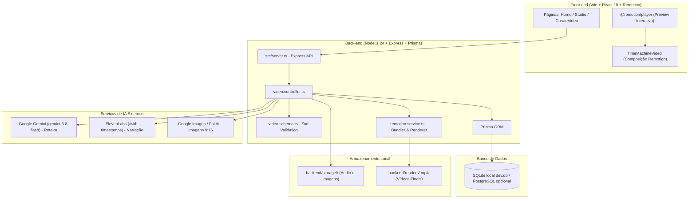

# AGENT.md — Fragata Shorts: Diretrizes de Engenharia e Arquitetura

> **Aviso Obrigatório para Agentes de IA e Desenvolvedores:**  
> A cada alteração, refatoração, correção ou adição feita no repositório, **é obrigatório informar e documentar explicitamente a mudança realizada**, detalhando os arquivos impactados, a motivação técnica e as verificações executadas. Mantenha também a seção [Histórico de Mudanças](#histórico-de-mudanças) deste arquivo sempre atualizada.

---

## 1. Visão Geral do Projeto

O **Fragata Shorts** é uma plataforma e Prova de Conceito (POC) de um motor automatizado e assistido para geração de vídeos curtos em formato vertical (`9:16`) focados em fatos históricos e narrativas ("Máquina do Tempo") para o TikTok, YouTube Shorts e Instagram Reels.

O sistema integra modelos de Inteligência Artificial generativa para escrita de roteiro, geração de imagens de fundo históricas, narração com voz neural sincronizada no nível de caracteres/palavras e renderização de vídeo programática utilizando o **Remotion**.

### Pilares de Valor do Projeto:
1. **Automação Inteligente com Controle Granular**: Capacidade de gerar vídeos de ponta a ponta com um clique ou editar individualmente roteiro, cenas, prompts, vozes e timing no Studio.
2. **Zero Desperdício de Créditos de IA**: Assets brutos (áudio, imagens, roteiro) são cacheados e persistidos no banco de dados (`remotionProps`) e em disco (`backend/storage/<id>/`). Re-renderizações ou ajustes de legenda não reexecutam chamadas pagas de IA.
3. **Sincronia Precisa de Fala e Legendas**: Uso de timestamps reais retornados pela API de TTS para calcular frames exatos (30 fps) para legendas dinâmicas e transições visuais.

---

## 2. Arquitetura do Sistema



### 2.1. Backend (`backend/`)
- **Runtime**: Node.js 22+ / 24+ com suporte nativo a execução TypeScript (`node src/server.ts`).
- **Framework**: Express 4 com CORS e parsing JSON.
- **Validação de Contratos**: Zod para tipagem estrita de payloads de entrada/saída.
- **Banco de Dados**: SQLite local embutido (`file:./dev.db`) gerenciado via Prisma ORM (sem necessidade de Docker/admin), com suporte opcional a PostgreSQL em produção.
- **Renderização Headless**: `@remotion/bundler` e `@remotion/renderer` para empacotar o código React e renderizar vídeos MP4 em segundo plano.
- **Serviços de IA**:
  - `gemini.service.ts`: Roteirização via `@google/genai` (`gemini-3.8-flash`) com structured JSON output.
  - `elevenlabs.service.ts`: Síntese de voz com alinhamento temporal nativo caractere a caractere (`/with-timestamps`).
  - `imagen.service.ts`: Geração de cenários verticais `9:16` com Gemini Image ou Fal AI.
  - `remotion.service.ts`: Orquestração de bundling Webpack e renderização MP4 via Remotion.

### 2.2. Frontend (`frontend/`)
- **Build Tool**: Vite 6 com React 18 e TypeScript.
- **Roteamento**: React Router v7 (`/`, `/create`, `/video/:id`).
- **Estilização**: Tailwind CSS.
- **Composições Remotion**:
  - `src/remotion/Root.tsx`: Declaração da composição principal `TimeMachineComposition`.
  - `src/remotion/TimeMachineVideo.tsx`: Timeline com `AudioTrack`, `Background`, `Avatar` e `Subtitles`.
  - `@remotion/player`: Reprodução em tempo real no Studio com suporte a scrub e playback instantâneo.

---

## 3. Estrutura do Repositório

```text
tiktok-videos/
├── .gitignore
├── .gitattributes
├── package.json                      # Scripts de orquestração do monorepo (root)
├── docker-compose.yml                # Contêiner PostgreSQL (tiktok-time-machine-db)
├── AI_PIPELINE_ARCHITECTURE.md       # Documento de arquitetura detalhada dos 3 pilares de IA
├── AGENT.md                          # Este manual de governança e arquitetura
│
├── backend/
│   ├── .env.example                  # Variáveis de ambiente necessárias
│   ├── package.json                  # Dependências do backend
│   ├── tsconfig.json                 # Configuração TypeScript NodeNext
│   ├── prisma/
│   │   └── schema.prisma             # Modelo de dados Video (PostgreSQL)
│   ├── renders/                      # Diretório de saída dos ficheiros .mp4 renderizados
│   ├── storage/                      # Cache de mídias brutas (<id>/audio.mp3, scene_*.jpg)
│   └── src/
│       ├── server.ts                 # Ponto de entrada do servidor Express
│       ├── controllers/
│       │   └── video.controller.ts   # Ações de criação, geração e renderização
│       ├── lib/
│       │   └── prisma.ts             # Instância singleton do Prisma Client
│       ├── routes/
│       │   └── video.routes.ts       # Declaração das rotas REST
│       ├── schemas/
│       │   └── video.schema.ts       # Validações Zod
│       └── services/
│           ├── elevenlabs.service.ts # Integração TTS + Timestamps
│           ├── gemini.service.ts     # Geração de Roteiro
│           ├── imagen.service.ts     # Geração de B-roll e Cenários
│           └── remotion.service.ts   # Bundling e renderização de vídeo
│
└── frontend/
    ├── package.json                  # Dependências do frontend
    ├── vite.config.ts                # Configuração do Vite
    ├── remotion.config.ts            # Configuração do Remotion
    ├── tailwind.config.js            # Design tokens e Tailwind CSS
    ├── tsconfig.json                 # Tipagem TypeScript do frontend
    ├── public/
    │   ├── avatars/                  # Sprites 2D do personagem/avatar
    │   └── ...                       # Assets estáticos padrão
    └── src/
        ├── main.tsx                  # Ponto de entrada React
        ├── App.tsx                   # Definição de rotas do SPA
        ├── pages/
        │   ├── Home.tsx              # Listagem de vídeos existentes
        │   ├── CreateVideo.tsx       # Criação rápida
        │   └── Studio.tsx            # Editor granular completo de storyboard & preview
        └── remotion/
            ├── index.ts              # Ponto de entrada do Remotion Studio
            ├── Root.tsx              # Registro da Composição Remotion
            ├── TimeMachineVideo.tsx  # Timeline do vídeo final
            ├── types.ts              # Definições de tipos de dados partilhados
            └── components/
                ├── AudioTrack.tsx    # Reprodução do áudio narrado
                ├── Avatar.tsx        # Exibição do avatar conforme timestamps
                ├── Background.tsx    # Transições de cenários b-roll
                └── Subtitles.tsx     # Legendas dinâmicas agrupadas em 3-5 palavras
```

---

## 4. Pipeline de Geração e Rotas da API

| Rota | Método | Descrição |
| :--- | :--- | :--- |
| `/health` | `GET` | Healthcheck do serviço backend |
| `/api/videos` | `GET` | Lista todos os vídeos criados no banco |
| `/api/videos/:id` | `GET` | Retorna os detalhes de um vídeo e suas `remotionProps` |
| `/api/videos` | `POST` | Cria um rascunho (`DRAFT`) sem custo de IA |
| `/api/videos/:id/generate-script` | `POST` | Etapa 1: Gera roteiro estruturado com o Gemini |
| `/api/videos/:id/generate-scene-images` | `POST` | Etapa 3A: Gera opções de imagens B-Roll para uma cena |
| `/api/videos/:id/generate-audio` | `POST` | Etapa 3B: Gera narração ElevenLabs e timestamps |
| `/api/videos/:id/render` | `POST` | Etapa 5: Renderiza o vídeo final MP4 em disco |
| `/api/videos/:id/rerender` | `POST` | Re-renderiza MP4 reaproveitando assets locais |
| `/api/generate-video` | `POST` | Rota legada de automação ponta a ponta |

---

## 5. Regras Obrigatórias de Governança para Agentes e Desenvolvedores

### 1. Comunicação Obrigatória de Cada Mudança
- **Qualquer alteração efetuada no código**, em arquivos de configuração, scripts, banco de dados ou documentação **deve ser explicitamente descrita e reportada**.
- Indique:
  1. O que foi modificado;
  2. Por que foi modificado;
  3. Quais arquivos foram tocados;
  4. Quais testes/validações foram executados para garantir que não houve regressões.
- Mantenha a seção [Histórico de Mudanças](#histórico-de-mudanças) deste arquivo (`AGENT.md`) sempre atualizada com as entradas correspondentes.

### 2. Ambiente Node.js e Execução de Comandos (Windows)
- Conforme as regras do ambiente do usuário, sempre que executar comandos do ecossistema Node.js (`node`, `npm`, `npx`, `vite`, etc.) onde o executável não estiver no `PATH` padrão do PowerShell:
  1. Verifique se `D:\Node` está presente.
  2. Execute todos os comandos através do terminal `cmd` com o `PATH` configurado:
     ```powershell
     cmd /c "set PATH=D:\Node;%PATH% && <comando>"
     ```
  3. Não baixe novas instalações do Node.js se `D:\Node` estiver presente.

### 3. Alinhamento de Versões do Remotion
- Pacotes do ecossistema Remotion (`remotion`, `@remotion/bundler`, `@remotion/renderer`, `@remotion/player`, `@remotion/cli`) **devem sempre permanecer exatamente na mesma versão**. Descompassos de versão entre frontend e backend causam erros de serialização de webpack ou divergências na timeline.

### 4. Segurança de Dependências
- Mantenha auditorias de segurança (`npm audit`) sem vulnerabilidades de severidade Alta ou Crítica.
- Atualizações de segurança não devem quebrar contratos de tipagem do TypeScript ou comportamento da pipeline de renderização.

### 5. Preservação de Dados e Comportamento
- Não delete sem autorização explícita as pastas `backend/storage/` ou `backend/renders/`, pois elas contêm mídias geradas com custo de API.
- Preserve o fallback de mocks e o isolamento de chamadas assíncronas no controlador para prevenir falhas silenciosas na renderização.

---

## 6. Comandos Operacionais Mais Usados

```bash
# Iniciar o banco de dados PostgreSQL via Docker
npm run db:up

# Sincronizar schema Prisma com o banco
npm run db:push

# Gerar o cliente Prisma
npm run db:generate

# Iniciar o servidor Backend (porta 3333)
npm run dev:backend

# Iniciar o servidor Frontend (porta 5173)
npm run dev:frontend

# Iniciar o Remotion Studio autônomo
npm run dev:studio
```

---

## 7. Histórico de Mudanças

| Data | Responsável | Escopo | Descrição da Mudança |
| :--- | :--- | :--- | :--- |
| **2026-11-09** | Antigravity Agent | Governança | Criação do arquivo inicial `AGENT.md` documentando a arquitetura do projeto, fluxos da pipeline, contratos de API e regras de comunicação obrigatória de alterações. |
| **2026-11-09** | Antigravity Agent | Segurança / Dependências | Correção de vulnerabilidades de segurança (`npm audit` zerado): atualização do ecossistema Remotion (`remotion`, `@remotion/bundler`, `@remotion/renderer`, `@remotion/player`, `@remotion/cli`) para `4.0.542`, `zod` para `^4.6.7` e inclusão de `overrides` para `deepmerge-ts` (`^8.0.0`). Validação completa de compilação do frontend e execução dos schemas e cliente Prisma no backend. |
| **2026-11-09** | Antigravity Agent | Identidade / Branding | Ajuste do nome da aplicação para **Fragata Shorts** em todo o frontend (HTML title, Home, Studio), backend (schemas, controllers, server, logs, healthcheck), prompts de IA (Gemini system instruction) e manifestos (`package.json` raiz, frontend e backend). |
| **2026-11-09** | Antigravity Agent | Banco de Dados / Infra | Migração do Prisma ORM de PostgreSQL (Docker) para SQLite local (`backend/prisma/dev.db`), eliminando a necessidade de contêineres Docker e privilégios administrativos na máquina local. Atualizados `.env.example`, `.env`, `.gitignore` e schema do Prisma sincronizado com sucesso via `db:push`. |
| **2026-11-09** | Antigravity Agent | UI / UX (Frontend NLE) | Refatoração completa da Ilha de Edição (`frontend/src/pages/Studio.tsx` e `frontend/src/index.css`) para layout de aplicação Desktop NLE (`h-screen overflow-hidden`, estilo CapCut/Filmora) com paleta escura (`#141414`/`#181818`/`#1e1e1e`) e destaque Teal (`teal-400`), menu horizontal de 3 abas no Inspetor (`1. Briefing`, `2. Storyboard`, `3. Legendas`), monitor `@remotion/player` 9:16 com controlos de transporte via `PlayerRef`, e Timeline Multi-Track (Vídeo, Áudio e Legendas) com régua de Timecode, Playhead vivo e clique para seek. |
| **2026-11-09** | Antigravity Agent | Polimento UI / Calibração NLE | Refinamento visual do `Studio.tsx` e `index.css` com base no protótipo de referência: fundo profundo `#0f0f11`, painéis modulares arredondados `#18181c` com bordas `#2c2c32`/50, destaque `amber-500`, abas horizontais com ícones (`📝`, `🎬`, `💬`) e sublinhado luminoso, cards de cena colapsáveis com galerias B-Roll 9:16 com overlay e badge verde `✓ Aprovada`, rodapé fixo na sidebar (`Gravar Narração` + `Montar Vídeo`), barra compacta de player com barra de progresso e mute, e Linha de Tempo com miniatura nas cenas, ondas de áudio (waveform) e agulha vermelha viva (`bg-red-500`). |
| **2026-11-09** | Antigravity Agent | Ajustes Finos UX (`Studio.tsx`) | Ajustes no `frontend/src/pages/Studio.tsx`: renomeação das abas para `1. Roteiro` e `2. Cenas`; botão de retorno ao Dashboard contendo apenas ícone SVG de seta; remoção da pílula `DRAFT`; substituição do botão de exportação direto por menu dropdown de 3 pontos verticais (`⋮`) com opção `Exportar MP4`; unificação da largura da barra de controles com o container 9:16 do vídeo; remoção do botão duplicado de pause; adição de clique direto no vídeo para play/pause e indicador central `Pausado` quando o vídeo não está em reprodução. |
| **2026-11-09** | Antigravity Agent | Preview B-Roll & Scrubbing na Timeline (`Studio.tsx`) | Adicionado botão de ampliação (`top-2 right-2`, visível no hover) nos cards de imagem B-Roll da aba `2. Cenas` que abre um modal Lightbox para visualizar o cenário `9:16` em alta definição (com alternância entre opções e seleção direta). Convertida a agulha vermelha (playhead) e a área da `Linha de Tempo` para suportar arraste contínuo (`mousedown` + `mousemove` + `mouseup`), atualizando em tempo real o frame no `@remotion/player` (cenários, avatar e legendas) e destacando visualmente a cena e a legenda ativas no momento da agulha. |
| **2026-11-09** | Antigravity Agent | Sistema de Estilos de Legendas Sincronizadas & Posicionamento (`Subtitles.tsx`, `Studio.tsx`, `elevenlabs.service.ts`) | Implementado o sistema de legendas customizáveis e sincronizadas: (1) Quebra automática de falas longas em blocos curtos de 3 a 4 palavras com tempos por palavra (`words`), tanto a partir dos timestamps de caracteres da ElevenLabs quanto de forma proporcional no modo `DRAFT/Preview`; (2) Painel de estilos na aba `3. Legendas` com escolha de animação (`Karaokê`, `Pop TikTok`, `Hormozi`), fonte (`Impacto`, `Montserrat`, `Grotesque`, `Script`), slider de tamanho, seletores de Cor Principal e Cor de Destaque, interruptores de Borda Preta, Sombra e Fundo Box; (3) Posicionamento interativo por presets/sliders na aba 3 e por arraste direto da alça sobre o vídeo 9:16 (com `stopPropagation` para não disparar o Play/Pause do vídeo); (4) Persistência de `subtitleStyle` e `words` em `remotionProps` no banco de dados. |
| **2026-11-09** | Antigravity Agent | Seções Recolhíveis na Aba `3. Legendas` (`Studio.tsx`) | Adicionado comportamento de recolher/expandir (*accordion*) na aba `3. Legendas` do `frontend/src/pages/Studio.tsx` seguindo o padrão dos cards de cena: a seção **Estilo & Animação das Legendas** inicia recolhida (`isSubtitleStyleCollapsed = true`) e a seção **Blocos de Fala** inicia aberta (`isSubtitleBlocksCollapsed = false`). |
